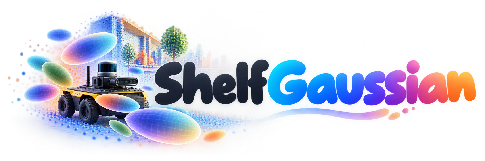

<div align="center">



# ShelfGaussian: Shelf-Supervised Open-Vocabulary Gaussian-based 3D Scene Understanding

Lingjun Zhao*, Yandong Luo*, James Hays, Lu Gan<br>
<sup>*</sup>Equal Contribution<br>
Georgia Institute of Technology

**CVPR 2026 Findings**

[Project Page](https://lunarlab-gatech.github.io/ShelfGaussian/) | [arXiv](https://arxiv.org/abs/2512.03370)

</div>

## News

* ***10/2026:*** Code is open-sourced. ShelfGaussian features a highly efficient CUDA-accelerated Gaussian voxelizer ([`third_party/CudaGaussianVoxelizer`](third_party/CudaGaussianVoxelizer); maintained at [ShelfGaussian-CudaGaussianVoxelizer](https://github.com/lunarlab-gatech/ShelfGaussian-CudaGaussianVoxelizer)), up to **221×** / **5×** faster and **4.6×** / **2.6×** more memory-efficient than the splatting in GaussTR / GaussianFormer.
* ***03/2026:*** ShelfGaussian has been accepted to CVPR 2026 Findings. 🎉

## Overview

ShelfGaussian is a multi-modal Gaussian transformer that predicts feed-forward 3D Gaussians from camera, LiDAR and/or radar inputs. The Gaussians are trained without any 3D annotations, using only off-the-shelf vision foundation models (shelf supervision): they are rendered into camera views and aligned with DINOv2 features (2D), and voxelized and aligned with DINOv2-featured LiDAR pseudo labels (3D). Through text embeddings in the same feature space (Talk2DINO), the Gaussians support zero-shot open-vocabulary 3D semantic occupancy prediction.

This repository contains the code for zero-shot semantic occupancy prediction on Occ3D-nuScenes.

## Installation

The code is tested with Python 3.10, PyTorch 2.1.2 and CUDA 11.8 / 12.1.

```bash
git clone https://github.com/lunarlab-gatech/ShelfGaussian.git
cd ShelfGaussian
conda create -n shelfgaussian python=3.10 -y
conda activate shelfgaussian

# 1. PyTorch + OpenMMLab (choose your CUDA version)
pip install -r requirements_cuda118.txt   # or requirements_cuda121.txt

# If mmcv was installed without its CUDA ops (ModuleNotFoundError: No module named 'mmcv._ext'):
# pip uninstall -y mmcv && pip install mmcv==2.1.0 -f https://download.openmmlab.com/mmcv/dist/cu118/torch2.1/index.html

# 2. gsplat (choose the wheel matching your CUDA version)
pip install https://github.com/nerfstudio-project/gsplat/releases/download/v1.4.0/gsplat-1.4.0%2Bpt21cu118-cp310-cp310-linux_x86_64.whl
# pip install https://github.com/nerfstudio-project/gsplat/releases/download/v1.4.0/gsplat-1.4.0%2Bpt21cu121-cp310-cp310-linux_x86_64.whl

# 3. CUDA Gaussian voxelizer (requires a CUDA toolkit matching PyTorch)
#    A copy is bundled here; it is maintained at https://github.com/lunarlab-gatech/ShelfGaussian-CudaGaussianVoxelizer
pip install -e third_party/CudaGaussianVoxelizer --no-build-isolation
```

## Pretrained Weights

Download the following files from the [Releases](https://github.com/lunarlab-gatech/ShelfGaussian/releases/tag/v1.0) page into `ckpts/`:

| File | Description | Needed by |
| --- | --- | --- |
| `text_proto_embeds_talk2dino_customized.pth` | Talk2DINO text embeddings of the 18 Occ3D classes (see [below](#text-embeddings)) | all models |
| `futr3d_lidar_0075_900q.pth` | [FUTR3D](https://github.com/Tsinghua-MARS-Lab/futr3d) LiDAR backbone, used for initialization | L / CR / LC / LCR |
| `futr3d_cam_radar.pth` | [FUTR3D](https://github.com/Tsinghua-MARS-Lab/futr3d) radar backbone, used for initialization | CR / LCR |

```bash
mkdir -p ckpts && cd ckpts
for f in text_proto_embeds_talk2dino_customized.pth futr3d_lidar_0075_900q.pth futr3d_cam_radar.pth; do
  wget https://github.com/lunarlab-gatech/ShelfGaussian/releases/download/v1.0/$f
done
cd ..
```

The FUTR3D weights are loaded whenever these models are built, so they are also needed for testing. The DINOv2 ViT-B/14 image backbone is downloaded automatically through `torch.hub`. Model checkpoints are listed in the [Model Zoo](#model-zoo).

## Data Preparation

The final layout is:

```
data/
├── nuscenes/
│   ├── maps/  samples/  sweeps/  v1.0-trainval/
│   ├── gts/                                      # Occ3D-nuScenes labels (evaluation only)
│   ├── depth_gt/                                 # step 3
│   ├── nuscenes_infos_{train,val}.pkl            # step 2
│   └── nuscenes_infos_{train,val}_lidar_radar_sweeps.pkl   # step 2
├── nuscenes_metric3d/                            # step 4
├── nuscenes_pseudo_binary_gt/                    # step 5 (training only)
└── nuscenes_pseudo_dinov2_gt/                    # step 5 (training only)
```

1. **nuScenes and Occ3D.** Download the [nuScenes](https://www.nuscenes.org/download) v1.0 full dataset (including the radar sweeps) to `data/nuscenes`. Download the Occ3D-nuScenes labels from [CVPR2023-3D-Occupancy-Prediction](https://github.com/CVPR2023-3D-Occupancy-Prediction/CVPR2023-3D-Occupancy-Prediction) to `data/nuscenes/gts`. The Occ3D labels are only used for evaluation.

2. **Info files.** Generate the mmdetection3d infos, then add scene indices and LiDAR / radar sweeps:

    ```bash
    mim run mmdet3d create_data nuscenes --root-path ./data/nuscenes --out-dir ./data/nuscenes --extra-tag nuscenes
    python tools/create_data.py --root-path ./data/nuscenes
    ```

3. **LiDAR depth.** Project the key-frame LiDAR points onto the images (format of [BEVDepth](https://github.com/Megvii-BaseDetection/BEVDepth)):

    ```bash
    python tools/data_generation/generate_lidar_depth.py --data-root data/nuscenes
    ```

4. **Monocular depth.** Estimate metric depth with [Metric3D v2](https://github.com/YvanYin/Metric3D) (ViT-L, loaded through `torch.hub`):

    ```bash
    PYTHONPATH=. python tools/generate_depth.py
    ```

    If you hit `RuntimeError: Failed to find function: mono.model.backbones.vit_large_reg`, add `from mono.model.backbones import *` to `~/.cache/torch/hub/yvanyin_metric3d_main/mono/utils/comm.py` ([Metric3D #151](https://github.com/YvanYin/Metric3D/issues/151)).

5. **3D pseudo labels (training only).** LiDAR key frames of each scene are accumulated (static background plus re-posed objects, following [LOcc](https://github.com/pkqbajng/LOcc)), restricted to points visible in the cameras, and voxelized on the Occ3D grid (200 × 200 × 16, 0.4 m). The binary labels supervise occupancy. The DINOv2 labels give each voxel the mean DINOv2 ViT-B/14 feature of its points, compressed to 128 dimensions with PCA.

    ```bash
    python tools/data_generation/generate_pseudo_occ.py --type binary
    python tools/data_generation/generate_pseudo_occ.py --type dinov2
    ```

    Both scripts process the 850 trainval scenes; use `--start` / `--end` (scene indices) to split the work across processes or GPUs (`--gpu-id`). **Disk space:** each DINOv2 label is a 200 × 200 × 16 × 128 float32 tensor (~330 MB), about 11 TB for all 34,149 samples. Most voxels are empty, so a file system with transparent compression (e.g. ZFS with lz4) reduces this to roughly 1 TB.

### Text Embeddings

`text_proto_embeds_talk2dino_customized.pth` contains one embedding per Occ3D class, averaged over several prompts (e.g. *"a car"*, *"a sedan"*, *"an SUV"*), encoded by CLIP and projected to the DINOv2 space by [Talk2DINO](https://github.com/lorebianchi98/Talk2DINO). To regenerate it or try your own prompts, edit `CLASS_PROMPTS` in `tools/data_generation/generate_text_embeddings.py` and run it in a Talk2DINO environment:

```bash
python tools/data_generation/generate_text_embeddings.py --talk2dino-root /path/to/Talk2DINO \
    --out ckpts/text_proto_embeds_talk2dino_customized.pth
```

## Model Zoo

Zero-shot semantic occupancy prediction on the Occ3D-nuScenes validation set (camera-visible voxels). C, L and R denote camera, LiDAR and radar.

| Model | Modality | IoU (paper) | mIoU (paper) | IoU (fixed eval) | mIoU (fixed eval) | Config | Checkpoint |
| --- | --- | --- | --- | --- | --- | --- | --- |
| ShelfGaussian-C | C | 63.25 | 19.07 | 62.80 | 18.85 | [config](configs/shelfgaussian_c.py) | [checkpoint](https://github.com/lunarlab-gatech/ShelfGaussian/releases/download/v1.0/shelfgaussian_c.pth) |
| ShelfGaussian-L | L | 66.10 | 19.34 | 66.56 | 19.84 | [config](configs/shelfgaussian_l.py) | [checkpoint](https://github.com/lunarlab-gatech/ShelfGaussian/releases/download/v1.0/shelfgaussian_l.pth) |
| ShelfGaussian-CR | C+R | 62.84 | 19.42 | 65.89 | 20.14 | [config](configs/shelfgaussian_cr.py) | [checkpoint](https://github.com/lunarlab-gatech/ShelfGaussian/releases/download/v1.0/shelfgaussian_cr.pth) |
| ShelfGaussian-LC | L+C | 69.24 | 21.52 | 71.77 | 22.23 | [config](configs/shelfgaussian_lc.py) | [checkpoint](https://github.com/lunarlab-gatech/ShelfGaussian/releases/download/v1.0/shelfgaussian_lc.pth) |
| ShelfGaussian-LCR | L+C+R | 69.45 | 21.78 | 72.03 | 22.54 | [config](configs/shelfgaussian_lcr.py) | [checkpoint](https://github.com/lunarlab-gatech/ShelfGaussian/releases/download/v1.0/shelfgaussian_lcr.pth) |

**Note on evaluation.** We fixed a bug in the occupancy metric inherited from the original codebase: in multi-GPU evaluation only the samples on the first GPU were scored, and the statistics were accumulated across repeated evaluations instead of being reset. The *paper* columns are the results reported in the paper; the *fixed eval* columns are the results of the released checkpoints with the corrected metric on the full validation set, which is what this code reproduces. The query reference points are randomly initialized at inference, so results may vary slightly between runs.

## Training and Evaluation

Models are trained for 24 epochs on 8 GPUs with 1 sample per GPU:

```bash
bash dist_train.sh configs/shelfgaussian_lcr.py 8
```

Evaluate a checkpoint:

```bash
PYTHONPATH=. mim test mmdet3d configs/shelfgaussian_lcr.py -C ckpts/shelfgaussian_lcr.pth -l pytorch -G 8
```

## Citation

If you find ShelfGaussian useful, please consider citing:

```bibtex
@inproceedings{zhao2026shelfgaussian,
    title     = {ShelfGaussian: Shelf-Supervised Open-Vocabulary Gaussian-based 3D Scene Understanding},
    author    = {Zhao, Lingjun and Luo, Yandong and Hays, James and Gan, Lu},
    booktitle = {Findings of the IEEE/CVF Conference on Computer Vision and Pattern Recognition (CVPR)},
    year      = {2026}
}
```

## Acknowledgements

This project is built upon [GaussTR](https://github.com/hustvl/GaussTR). We also thank [Talk2DINO](https://github.com/lorebianchi98/Talk2DINO), [DINOv2](https://github.com/facebookresearch/dinov2), [LOcc](https://github.com/pkqbajng/LOcc), [FUTR3D](https://github.com/Tsinghua-MARS-Lab/futr3d), [CRKD](https://github.com/Song-Jingyu/CRKD), [BEVDepth](https://github.com/Megvii-BaseDetection/BEVDepth), [Metric3D](https://github.com/YvanYin/Metric3D), [gsplat](https://github.com/nerfstudio-project/gsplat), [Occ3D](https://github.com/Tsinghua-MARS-Lab/Occ3D) and [MMDetection3D](https://github.com/open-mmlab/mmdetection3d) for their open-source contributions.

## License

Released under the [MIT](LICENSE) License.
